<picture>
  <source media="(prefers-color-scheme: dark)" srcset="assets/banner-dark.svg">
  
</picture>
 

Hi, I'm Jolly. I build AI automations and agent systems out of the Philippines: GoHighLevel, Make, n8n and Claude Code, wired together so the busy work runs on its own. I ship in small pieces and keep what works.

### Now building

<picture>
  <source media="(prefers-color-scheme: dark)" srcset="assets/greeter-dark.svg">
  
</picture>
 

- **[job-fit-scorer](https://github.com/koaisomi/job-fit-scorer)** - a browser extension that scores a job post against your resume before you spend time applying.
- **[model-orchestrator](https://github.com/koaisomi/model-orchestrator)** - routes each task to the right Claude model: plan, build, review, verify.
- **Ground Zero HQ** - my agent office: a team of Claude agents with departments, a task board and an Owner GO gate on anything risky.
- **Maxim** - a desktop and phone assistant that runs that team for me.

### Find me

[Portfolio](https://jollyluna.vercel.app) · [LinkedIn](https://www.linkedin.com/in/jollyluna-automation/)
